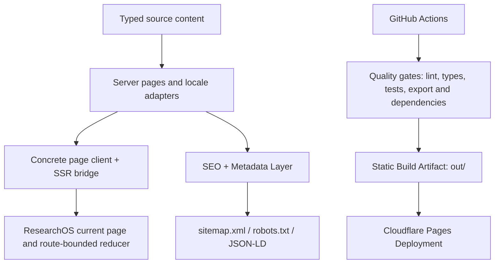

# Mohammad Raouf Abedini Portfolio

Next.js portfolio for AI security research, cybersecurity engineering projects, technical articles and lab experiments.

[Live Site](https://raoufabedini.dev) · [Security Policy](./SECURITY.md) · [Architecture](./docs/ARCHITECTURE.md) · [API/Data Reference](./docs/API_REFERENCE.md)

## Highlights

- Next.js App Router with static export deployed to Cloudflare Pages.
- Strict TypeScript, ESLint, Vitest and an exported-route audit.
- Security-first content and disclosure workflow (`security.txt`, Hall of Fame, policy page).
- ResearchOS welcome screen, dock and one current route-backed reading window with bounded movement/resize, minimize/restore and maximize/restore.
- Retained application state on desktop and a single foreground reading panel on phones, with keyboard and single-pointer alternatives to dragging.
- 13 project dossiers with search, category filtering and on-demand previews of the original artwork.
- Technical articles, a separate publication library indexed by global search, and direct access to résumé skills, experience and certifications.
- English, Persian, Arabic, Chinese and Spanish content, including RTL layouts.

## Tech Stack

- Framework: Next.js 16, React 19, TypeScript
- Styling: Tailwind CSS 4
- Motion/UI: native CSS, original SVG/Canvas artwork and Lucide React; Framer Motion remains installed for retained legacy components.
- Testing: Vitest + React Testing Library + jsdom
- CI/CD: GitHub Actions with Cloudflare Pages deployment

## Architecture



Detailed design notes are documented in [docs/ARCHITECTURE.md](./docs/ARCHITECTURE.md).

Current handover (12 October 2026): work is on `main-proof-atlas-2026-10-11` with local export `RAlsc85jKQO_lr4A2e_Ie` at `00ce522dc4c247a15a0fcfb42a280c20c1935cf4`. All five languages remain; Australian English spelling applies to English copy only. The lock screen no longer renders Proof Atlas; the unlocked Atlas and evidence remain. Current tests, build and browser evidence, historical performance identities, limitations and outstanding acceptance work are recorded in the [Portfolio handover](./docs/portfolio-handover-2026-10-12.md). No performance rerun was made on this export. Production has not been reverified or updated, and field CWV, physical-device, screen-reader and remote CI proof remain absent. No listener is currently running on the previously used preview address `127.0.0.1:4398`. The prior frontend-gauntlet and build-10 paragraph below is retained as historical context.

The independent-window continuation is implemented on `main-frontend-gauntlet-2026-10-10`. Frozen build 10 passes 468 tests in 33 files, lint, typecheck, 168 generated pages and the 160-route export audit. It improves Light Welcome text contrast while preserving layout and stronger-contrast preferences. The scoped native review covers 1,280 default frames across 160 routes plus 40 unlocked-home frames, retaining actual build 6/8 capture identities and qualified later projections. Build 9 actual zoom/reflow and five-language window checks retain their separate identities. Original project previews, five languages and research evidence are preserved. The reviewed private development dependency is now installed. Fresh local integration passes ordinary `npm ci`, lint with zero errors and one existing local temporary-file warning, typecheck, 468 application tests in 33 files, three dependency-security tests, six schema tests, 168 generated pages, the 160-route export audit and full/runtime audits with zero advisories. The final frozen-source/export report records the exact handoff identity; historical captures and results keep their original build labels. Publication still requires explicit approval. Field performance, physical-device, screen-reader and remote CI proof remain separate. See the [maintenance instructions](./docs/dependency-security.md) and [goal checklist](./docs/research-os-goal-checklist.md). No push, merge or deployment has occurred.

## Repository Structure

```text
.
├── .github/workflows/        # CI and deployment automation
├── docs/                     # Architecture and project references
├── public/                   # Static assets + security.txt + llms.txt
├── src/
│   ├── app/                  # Route segments and metadata routes
│   ├── components/           # UI and layout components
│   ├── lib/                  # Constants, data model, utility functions
│   └── test/                 # Test setup
├── AGENT.md                  # Local AI assistant governance
├── CHANGELOG.md              # Change history
├── SECURITY.md               # Vulnerability disclosure process
└── README.md
```

## Local Development

### Prerequisites

- Node.js `22.x`, at least `22.12.0` (see [`.nvmrc`](./.nvmrc)); Node.js 24 is also supported by the package engines.
- npm `10+`

### Setup

```bash
git clone https://github.com/Raoof128/Portfolio.git
cd Portfolio
nvm use
npm ci
npm run dev
```

Open `http://localhost:3000`.

Choose **Enter workspace**, open Projects, type a search, then open About. Opening another page disposes the previous window; there is no opened-page history strip. Minimize temporarily preserves only the current page, with one restore button and a dock indicator. Desktop title dragging and the resize handle have a **Window controls** menu with click steps and keyboard arrows; phones use ordinary document scrolling. Direct content URLs open immediately. Only the appearance preference persists across reloads; the current page’s filters, geometry and reading position are temporary state that ends when navigating away.

## Quality Commands

```bash
npm run lint
npm run typecheck
npm run test:ci
npm run test:schemas
npm run test:backend
npm run test:dependency-security
npm run test:coverage
npm run build
npm run audit:agents
npm audit --omit=dev --audit-level=high
npm audit --audit-level=high
```

The [CUA workspace regression helper](./scripts/browser-regressions/researchos-workspace.cua.mjs) runs through an owned Codex browser tab, not Node or an external browser driver. Its supported API, hydration readiness and coverage limits are documented in [Run and review](./docs/research-os-implementation.md#run-and-review).

## Deployment

Server-side work runs during the static build: localized pages, metadata, RSS,
sitemap, crawler text and the deployment fingerprint. `npm run test:backend`
checks these input/output boundaries and the HTTP audit primitives sequentially.
See [backend validation](./docs/backend-validation.md) for scope and limits.
Run `npm run test:security` for the artifact boundary regressions and
`npm run audit:security` after building or transferring `out`. The
[security hardening guide](./docs/security-hardening.md) explains the redirect,
browser policy, disclosure and CI delivery checks, including their limits.
Unsupported locale strings fall back to English; unpublished project names return
the framework's 404 signal. Contact creates an email draft.

After building, `npm run audit:production -- http://127.0.0.1:4398` checks the
existing local preview. Use the default command after an approved production
deployment. Each request has a 10-second deadline and a 4 MiB decoded-body cap;
header-only probes cancel their bodies. Preview checks retain production
canonical URLs and skip the production-only `www` redirect. Incorrect content
types, redirect destinations, configured security headers, expired disclosure
contacts and missing deployment identity fail the audit.

This repository is deployed to Cloudflare Pages:

- `next.config.ts` uses `output: "export"` for static generation.
- Production site: `https://raoufabedini.dev`
- PR and branch quality checks run from `.github/workflows/ci.yml`.
- Deployment repeats the guarded dependency tests and full/export/runtime audits before uploading the artifact. Build tools run in a separate job from the deployment token.
- Preview `out/` with a static host that implements `public/_redirects` and `public/_headers`. `next start` does not serve a Next.js static export.
- The local candidate is an isolated export. Rebuild this checkout before deploying; only the artifact identified in the final frozen report is the reviewed export. Push, merge and deployment require explicit owner approval.

## Security

- Responsible disclosure: [SECURITY.md](./SECURITY.md)
- RFC 9116 contact file: [public/security.txt](./public/security.txt)
- Hall of Fame: `/hall-of-fame`

## Documentation Index

- [Architecture](./docs/ARCHITECTURE.md)
- [ResearchOS experience and verification](./docs/research-os-implementation.md)
- [ResearchOS goal and acceptance checklist](./docs/research-os-goal-checklist.md)
- [ResearchOS verification and release handoff](./docs/research-os-verification.md)
- [API/Data Reference](./docs/API_REFERENCE.md)
- [Mehr Guard Notes](./docs/MEHR_GUARD_README.md)
- [GitSwitch Notes](./docs/GITSWITCH_README.md)
- [ECRSM Notes](./docs/ECRSM_README.md)

## Contributing and License

- Contributing guide: [CONTRIBUTING.md](./CONTRIBUTING.md)
- Code of conduct: [CODE_OF_CONDUCT.md](./CODE_OF_CONDUCT.md)
- License: [MIT](./LICENSE)
