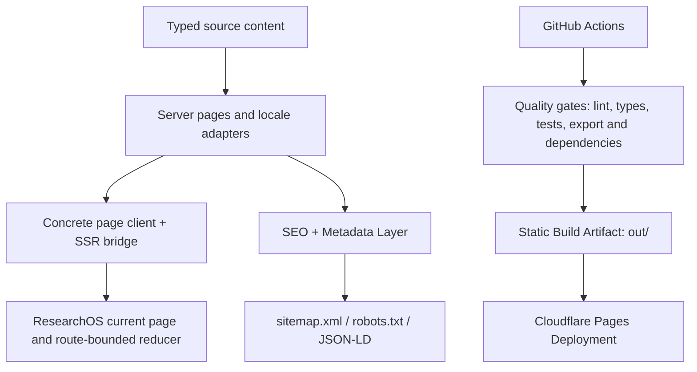

# Mohammad Raouf Abedini Portfolio

Next.js portfolio for AI security research, cybersecurity engineering projects, technical articles and lab experiments.

[Live Site](https://raoufabedini.dev) · [Security Policy](./SECURITY.md) · [Architecture](./docs/ARCHITECTURE.md) · [API/Data Reference](./docs/API_REFERENCE.md)

## Highlights

- Next.js App Router with static export deployed to Cloudflare Pages.
- Strict TypeScript, ESLint, Vitest and an exported-route audit.
- Security-first content and disclosure workflow (`security.txt`, Hall of Fame, policy page).
- ResearchOS welcome screen, dock and one current route-backed reading window with bounded movement/resize, minimize/restore and maximize/restore.
- Retained application state on desktop and a single foreground reading panel on phones, with keyboard and single-pointer alternatives to dragging.
- 14 project dossiers with search, category filtering and on-demand previews of the original artwork.
- Technical articles, a separate publication library indexed by global search, and direct access to résumé skills, experience and certifications.
- English, Persian, Arabic, Chinese and Spanish content, including RTL layouts.

## Tech Stack

- Framework: Next.js 16, React 19, TypeScript
- Styling: Tailwind CSS 4
- Motion/UI: native CSS, original SVG/Canvas artwork and Lucide React; Framer Motion remains installed for retained legacy components.
- Testing: Vitest + React Testing Library + jsdom
- CI/CD: GitHub Actions with Cloudflare Pages deployment

## Architecture



Detailed design notes are documented in [docs/ARCHITECTURE.md](./docs/ARCHITECTURE.md).

SentinelSSH joins the project explorer directly below Zurvan, with a five-language dossier, public repository link and a custom animated SVG inspection lens. See the [addition audit](./docs/audits/sentinel-ssh-2026-11-14/README.md).

Verified release (14 November 2026): the mobile minimise icon is centred (`36aaa80`), and an entered workspace stays open when the same tab reloads (`c25af79`). A fresh session or an explicit Lock still shows the welcome screen. Select the **Enter workspace** arrow to start the three-second loader; the portrait and name are passive. Direct content URLs open immediately. See the [release handover](./docs/portfolio-release-handover-2026-11-04.md) for deployment evidence, limitations and earlier releases.

The [12 October handover](./docs/portfolio-handover-2026-10-12.md), earlier frontend-gauntlet reports and build-10 evidence are historical. Their branch names, counts and no-deployment statements describe their original snapshots. Physical-device, assistive-technology, native-speaker and field Web Vitals verification remain separate; incomplete contrast and PDF-tagging limits are not cleared by deployment. The 14 November full dependency audit passed the high-severity gate and reported seven moderate tooling advisories. See the [maintenance instructions](./docs/dependency-security.md) and [goal checklist](./docs/research-os-goal-checklist.md).

## Repository Structure

```text
.
├── .github/workflows/        # CI and deployment automation
├── docs/                     # Architecture and project references
├── public/                   # Static assets + security.txt + llms.txt
├── src/
│   ├── app/                  # Route segments and metadata routes
│   ├── components/           # UI and layout components
│   ├── lib/                  # Constants, data model, utility functions
│   └── test/                 # Test setup
├── AGENT.md                  # Local AI assistant governance
├── CHANGELOG.md              # Change history
├── SECURITY.md               # Vulnerability disclosure process
└── README.md
```

## Local Development

### Prerequisites

- Node.js `22.x`, at least `22.13.0` (see [`.nvmrc`](./.nvmrc)); Node.js 24 is also supported by the package engines.
- npm `10+`

### Setup

```bash
git clone https://github.com/Raoof128/Portfolio.git
cd Portfolio
nvm use
npm ci
npm run dev
```

Open `http://localhost:3000`.

On a fresh session, select the **Enter workspace** arrow and wait three seconds, then open Projects, type a search, then open About. Opening another page disposes the previous window; there is no opened-page history strip. Minimize temporarily preserves only the current page, with one restore button and a dock indicator. Desktop title dragging and the resize handle have a **Window controls** menu with click steps and keyboard arrows; phones use ordinary document scrolling. Direct content URLs open immediately. Appearance and the tab’s entered or explicitly locked state persist across reloads when browser storage is available; the current page’s filters, geometry and reading position are temporary state that ends when navigating away.

## Quality Commands

```bash
npm run lint
npm run typecheck
npm run test:ci
npm run test:schemas
npm run test:backend
npm run test:dependency-security
npm run test:coverage
npm run build
npm run audit:agents
npm audit --omit=dev --audit-level=high
npm audit --audit-level=high
```

The [historical CUA workspace regression helper](./scripts/browser-regressions/researchos-workspace.cua.mjs) runs through an owned Codex browser tab, not Node or an external browser driver. Its old multiple-retained-window assertions are not current acceptance gates. Use `npm run test:browser -- --project=chromium` against a fresh Cloudflare Pages preview; setup, browser engines and review artifacts are documented in `docs/audits/frontend-review/README.md`. Historical API and coverage limits are documented in [Run and review](./docs/research-os-implementation.md#run-and-review).

## Deployment

Server-side work runs during the static build: localized pages, metadata, RSS,
sitemap, crawler text and the deployment fingerprint. `npm run test:backend`
checks these input/output boundaries and the HTTP audit primitives sequentially.
See [backend validation](./docs/backend-validation.md) for scope and limits.
Run `npm run test:security` for the artifact boundary regressions and
`npm run audit:security` after building or transferring `out`. The
[security hardening guide](./docs/security-hardening.md) explains the redirect,
browser policy, disclosure and CI delivery checks, including their limits.
Unsupported locale strings fall back to English; unpublished project names return
the framework's 404 signal. Contact creates an email draft.

After building, `npm run audit:production -- http://127.0.0.1:4398` checks the
existing local preview. Use the default command after an approved production
deployment. Each request has a 10-second deadline and a 4 MiB decoded-body cap;
header-only probes cancel their bodies. Preview checks retain production
canonical URLs and skip the production-only `www` redirect. Incorrect content
types, redirect destinations, configured security headers, expired disclosure
contacts and missing deployment identity fail the audit.

This repository is deployed to Cloudflare Pages:

- `next.config.ts` uses `output: "export"` for static generation.
- Production site: `https://raoufabedini.dev`
- PR and branch quality checks run from `.github/workflows/ci.yml`.
- Deployment repeats the guarded dependency tests and full/export/runtime audits before uploading the artifact. Build tools run in a separate job from the deployment token.
- Preview `out/` with a static host that implements `public/_redirects` and `public/_headers`. `next start` does not serve a Next.js static export.
- The local candidate is an isolated export. Rebuild this checkout before deploying; only the artifact identified in the final frozen report is the reviewed export. Push, merge and deployment require explicit owner approval.

## Security

- Responsible disclosure: [SECURITY.md](./SECURITY.md)
- RFC 9116 contact file: [public/security.txt](./public/security.txt)
- Hall of Fame: `/hall-of-fame`

## Documentation Index

- [Current release handover and Zurvan coverage](./docs/portfolio-release-handover-2026-11-04.md)
- [Architecture](./docs/ARCHITECTURE.md)
- [ResearchOS experience and verification](./docs/research-os-implementation.md)
- [ResearchOS goal and acceptance checklist](./docs/research-os-goal-checklist.md)
- [ResearchOS verification and release handoff](./docs/research-os-verification.md)
- [API/Data Reference](./docs/API_REFERENCE.md)
- [Mehr Guard Notes](./docs/MEHR_GUARD_README.md)
- [GitSwitch Notes](./docs/GITSWITCH_README.md)
- [ECRSM Notes](./docs/ECRSM_README.md)

## Contributing and License

- Contributing guide: [CONTRIBUTING.md](./CONTRIBUTING.md)
- Code of conduct: [CODE_OF_CONDUCT.md](./CODE_OF_CONDUCT.md)
- License: [MIT](./LICENSE)
