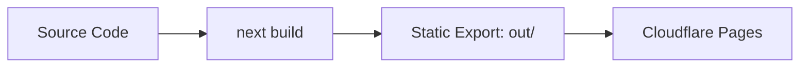
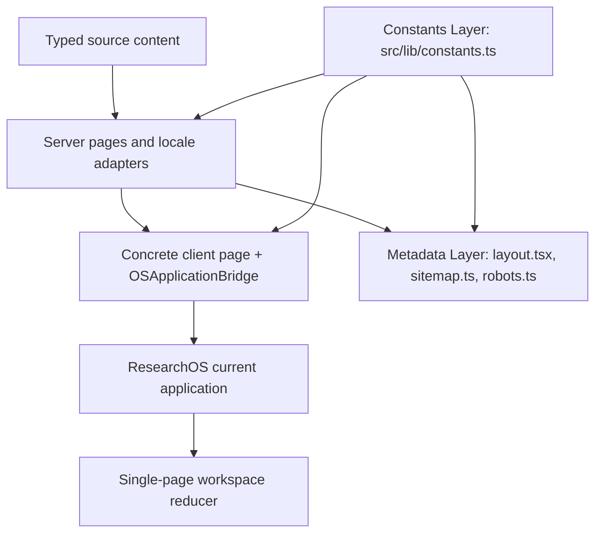

# Portfolio Architecture Overview

## 1. System Goals

- Serve a fast, static, publicly accessible portfolio website.
- Keep data centralized and strongly typed.
- Preserve security and SEO metadata as first-class concerns.
- Enforce repeatable quality gates before deployment.

## 2. Runtime Model

The application uses Next.js App Router and exports static files for Cloudflare Pages. The locale proxy runs during development; production rewrites and headers are defined in `public/_redirects` and `public/_headers`.



No server-side runtime API is required for production delivery.

## 3. Application Layers



### Route Layer (`src/app`)

- Defines page routes (`/`, `/projects`, `/lab`, `/write-ups`, etc.).
- Uses static params for dynamic segments (`[slug]`, `[id]`) to guarantee export-safe routing.
- Exposes SEO metadata via `metadata`, `generateMetadata`, `sitemap`, and `robots`.
- English has clean root URLs; Persian, Arabic, Chinese and Spanish use locale prefixes. Each page has its own canonical URL and reciprocal language alternates.
- Locale adapters select full document prose on the server. Lists and global search receive compact summaries; detail clients receive one document. Full inactive-language registries are not client props.

### UI Layer (`src/components`)

- `ResearchOS` owns the welcome interaction, dock, native search dialog, appearance preference and current-page registry. The welcome screen is not authentication.
- `OSApplicationBridge` publishes a concrete page client element and initial browser state; it never retains Next.js's opaque live router outlet. `WorkspaceWindows` renders only the current keyed application; `workspace-model` owns current-page replacement, minimize/restore and close transitions.
- `use-reading-window` and `window-geometry` own bounded movement, resize, saved maximize/restore bounds and reading-offset transitions. `ReadingWindowControls` supplies a nonmodal, shell-owned portal with single-pointer steps and keyboard alternatives.
- `ProjectExplorer` provides project navigation and literal search. `ProjectMotion` and `ProjectThumbnail` share the original-artwork registry and on-demand module cache. Thumbnails are decorative stills beside the real project heading and links.
- Document pages reuse native links, readable opaque surfaces and supporting UI primitives. Some legacy components remain tested but are not mounted by the current application.
- Route-specific client components render presentation and interactions.

### Independent application lifecycle

Server pages continue to select localized props and generate metadata, JSON-LD and static HTML. Each reading page wraps its concrete client leaf in `OSApplicationBridge`; structured-data scripts stay outside the bridge. The initial document remains readable during SSR. In a layout Effect, the bridge captures the project query/category, bounded named input values, focused input/caret and reading offset before the workspace handover. `ApplicationStateContext` supplies that initial snapshot to clients that consume it. React/JSDOM hydration tests exercise draft and caret preservation; native autofill remains a separate browser check.

The registry holds only the current page. Navigating to another page or the desktop disposes the previous subtree, drafts, geometry and effects. The descriptor validator accepts 31 reading routes per locale and rejects unknown or cross-locale descriptors. Minimize temporarily preserves only the current page, exposing one restore action; no opened-window strip or accumulated route history is rendered. Close returns to the desktop.

Next navigation continues to own URLs, fragments, metadata and normal browser back/forward behavior. There is no iframe, additional dependency, app-data endpoint or custom network loader. The current pane supplies the canonical main landmark and IDs. Minimized or locked content uses React `Activity` hidden mode to suspend effects; navigating away unmounts it.

Below the floating-layout thresholds (1024px wide and 600px high), one foreground document uses ordinary page scrolling. The reading hook records offsets separately from window geometry and restores them on app activation, minimize/restore and desktop/phone transitions. Desktop pointer operations are bounded, coalesced and cancelled on interruption. Maximize stores the previous rectangle; restore clamps it against the current viewport. The panel's reset action returns to default layout rather than the saved maximize rectangle.

Window records, geometry, filters, input state and reading positions are in-memory state for the mounted workspace. Reloading or leaving its locale resets them. The existing dark/light appearance value is the only setting stored locally.

### Data Layer (`src/lib/data.ts`)

- Single source of truth for:
  - Projects
  - Write-ups
  - Lab experiments
- Strong TypeScript interfaces ensure route and component consistency.
- `project-localization`, `localized-writing` and `localized-labs` preserve source evidence and select complete localized content. Missing translation coverage fails the build.
- Original PDFs, code examples, citations and technical identifiers retain their source language. Machine-readable dates and stable slugs remain unchanged.

### Constants Layer (`src/lib/constants.ts`)

- Centralizes canonical URLs and contact metadata.
- Prevents drift in structured metadata, sitemap, and UI links.

## 4. Security and SEO Design

- `SECURITY.md` + `public/security.txt` define disclosure and contact paths.
- JSON-LD Person schema is injected in root layout.
- Canonical URL + sitemap + robots are generated from shared constants.
- External links use `rel="noopener noreferrer"` where appropriate.
- Search renders text through React and never turns queries into markup or regular expressions. JSON-LD serialization escapes `<` before inline injection.
- Contact opens email drafts; no form backend, account session or secret is stored in the browser. The appearance preference is the only application setting persisted locally.
- The window descriptor validator accepts only the known route/locale inventory. It adds no arbitrary markup, executable user-provided content, remote app URL or persistence of retained input state.
- Cloudflare applies CSP and other security headers to the export. A plain local static server does not prove deployed header behavior.

## 5. Testing Strategy

- Unit tests for data model and utility behavior.
- Component tests cover previous-page disposal, a single-page reducer, current-page minimize/restore and close behavior, geometry and gesture interruption, reading offsets, maximize/restore, scoped IDs, portal/focus cleanup, search keyboard/IME behavior, localization and artwork loading/playback cleanup.
- Bridge tests include actual React `renderToString`/`hydrateRoot` handover in JSDOM. A separate build 6 native Chrome experiment pauses and releases 11 script requests and verifies a Projects query and caret across hydration. This is bounded pre-hydration typing proof; native autofill remains unverified.
- Historical build 6 helpers predate removal of multi-window retention and are not current acceptance gates. `scripts/browser-regressions/researchos-workspace.cua.mjs` provides a bounded local English desktop flow through the documented Codex CUA tab API. It waits for hydrated app panes and returns assertion evidence; manual pointer, phone, RTL, preference, accessibility and complete route checks remain separate.
- `scripts/browser-regressions/researchos-navigation.cua.mjs` covers retained publication search, fragments, history and exact maximize/restore geometry through the same owned-tab API. Build 6 passed both flows: 65 assertions at 1280×800 in Chrome 154. Their actual candidate identity remains attached when unchanged source is projected to build 9.
- The optional V8 coverage provider is pinned to the exact Vitest version. Coverage describes exercised code, not browser accessibility or visual conformance.
- Export checks audit every canonical route, metadata, schemas, language alternates, machine files and contact URI attributes.
- Browser checks remain necessary for native dialog behavior, rendering, responsive layout, preference fallbacks and hydration.

Build 10 passes the exact default CI command with 468 tests in 33 files, clean lint, typecheck, six schema tests, 168 generated pages and the 160-route export audit. Build 6 coverage retains its identity. The scoped default visual matrix combines 150 build 6 routes with ten build 8 Projects/Hall routes, totaling 1,280 frames; the unlocked-home supplement adds 40. Build 9's max-height320px rule moves navigation into document flow at short heights; native zoom/reflow checks pass 14 predicates. Five-language build 9 expand/restore, minimized descriptions and original title-language checks add 75 predicates; retained Lab motion adds eight. Build 10 changes only Light Welcome muted text, with a local stronger-contrast override and four regression tests. Source/compiled-style projection and fresh affected native checks qualify reuse; no historical screenshot is relabeled. Documentation is a compiler scanning input, so future release builds require fresh identity checks. See [research-os-goal-checklist.md](./research-os-goal-checklist.md).

Quality commands:

```bash
npm run lint
npm run typecheck
npm run test:ci
npm run test:schemas
npm run test:coverage
npm run build
npm run audit:agents
npm audit --omit=dev --audit-level=high
```

## 6. Delivery Pipeline

- CI workflow validates lint, types, tests, and production build.
- Both CI and deployment read Node.js 22 from `.nvmrc` and run guarded dependency tests plus full/export/runtime audits.
- The deployment build job must pass all gates before it uploads `out/`. The deploy job receives the Cloudflare token separately and publishes only from `main`.
- Full dependency audits also include development tools. Review advisory prerequisites and fixed versions; do not force framework downgrades to hide an unpatched transitive advisory.

### Recorded dependency audit (continuation candidate, checked 11 October 2026)

Next.js and its ESLint configuration remain pinned to 16.3.8; Vitest and its coverage provider remain pinned to 4.1.11. Build 10 retains the historical full-audit result: five high development paths for one unpatched upstream braces advisory, with zero runtime/critical entries. Current integration replaces only the affected development dependency with the attributed private `@researchos/braces-guard` 0.1.0 package. A root file dependency and `$` override install exact checked-in tarball bytes through the real Next ESLint chain. All prior unrelated lock entries are unchanged; npm normalization adds six optional WASI bundled records. No browser dependency is added.

The reviewed private development dependency is now installed. Fresh local integration passes ordinary `npm ci`, lint with zero errors and one existing local temporary-file warning, typecheck, 468 application tests in 33 files, three dependency-security tests, six schema tests, 168 generated pages, the 160-route export audit and full/runtime audits with zero advisories. The final frozen-source/export report records the exact handoff identity; historical captures and results keep their original build labels. Publication still requires explicit approval. Field performance, physical-device, screen-reader and remote CI proof remain separate. Registry auditing does not certify private fork source: independent provenance, compatibility, bounded regression and installed-consumer checks provide separate assurance. [Dependency maintenance](./dependency-security.md) documents origin, limits, archive parity, lint scoping, update/removal and the ESLint lifecycle limitation.

The advisory requires an attacker-controlled, deeply nested glob pattern. Here, the lint plugin receives the repository working directory and source-controlled settings; browser search does not call this dependency. This bounds the observed application exposure but does not fix or suppress the upstream advisory. Recheck the full audit when updating dependencies. The automatic forced remedy proposes downgrading the Next.js ESLint configuration to 14.2.35. This is a cross-major downgrade whose compatibility and preservation of lint behavior have not been verified, and it is not applied.

## 7. Key Tradeoffs

- Static export maximizes reliability and reduces attack surface, but avoids runtime backend features.
- Content is source-controlled for consistency, but requires code changes for content updates.
- Original project artwork is retained with reduced-motion stills, pause controls, background/offscreen suspension and disposal of timers/observers.
- Only the current app retains local state while minimized; navigation disposes it, and reload uses ordinary direct-route loading. Static HTML remains readable without JavaScript, while window management requires hydration.
