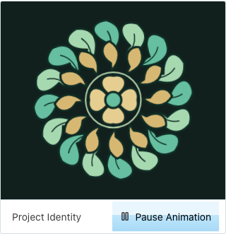
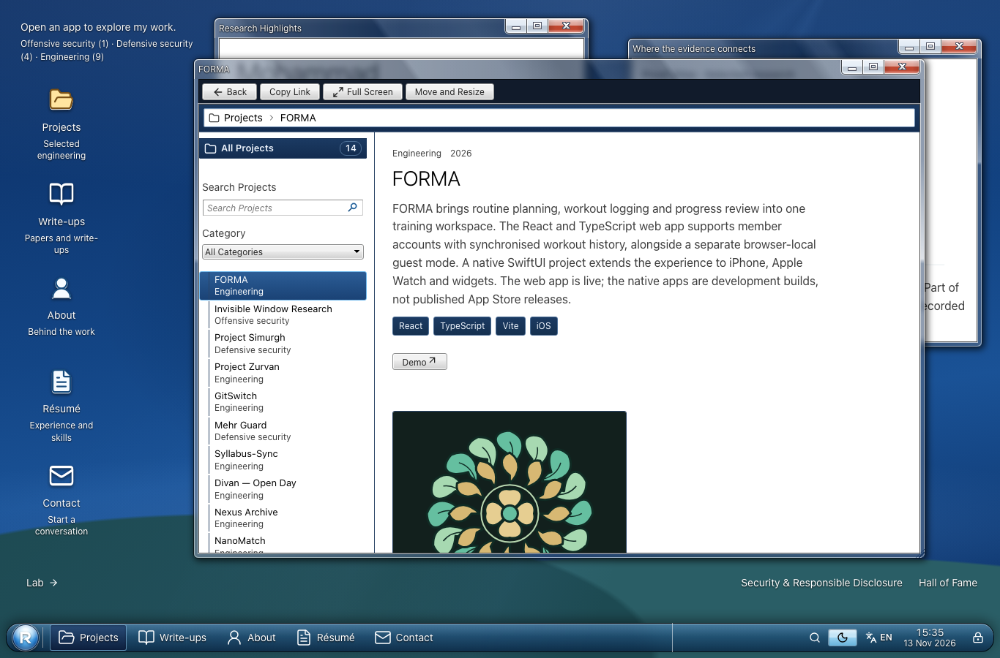
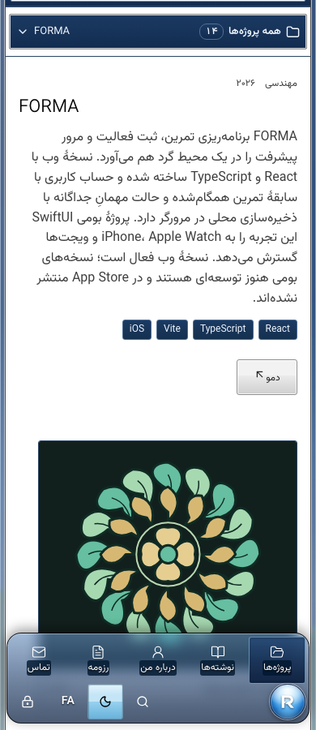

# FORMA portfolio page audit — 13 November 2026

Scope: the portfolio dossier at `/projects/forma`, its four translated routes,
project explorer, site-wide search, artwork lifecycle and shared 7.css controls.
This is an audit of the portfolio entry, not of the separate FORMA application.

The subsequent [animation refinement and Safari follow-up](animation-polish.md)
supersedes the original WebKit verification gap and records the revised artwork.

## Visual authority and method

The existing ResearchOS implementation and installed `7.css@0.21.1` are the
visual authority. The [official 7.css documentation](https://7css.vercel.app/)
was consulted for semantic controls, tabs, window structure and interaction states.
The existing application deliberately extends those primitives for its reading
windows, responsive layout and accessibility preferences.

Before editing, the live Syllabus-Sync lotus, GitSwitch dandelion, Nexus Archive
astrolabe, Mehr Guard helix and FORMA artwork were opened and captured. Six shared
selectors were compared across eleven computed properties each: dossier, lead,
resource link, artwork frame, animation button and search input. All 66 values
matched each reference page in the same resting state. This is measured CSS
parity for those controls, not a claim that different content has identical pixels.

The review covered ProjectDetailClient, ProjectExplorer, ProjectMotion,
ProjectThumbnail, ProjectDiagram, the artwork registry and pause hook, the
project/motion/thumbnail/Aero styles, data and translations, OS route schema,
search indexing and matching, static metadata, and the installed 7.css package.

## Findings and changes

| Severity | Finding | Resolution |
| --- | --- | --- |
| P2 | The original SMIL circle animation was conditionally removed when paused. This reset the pose and bypassed the shared CSS artwork pause mechanism. | Replaced with persistent CSS animations and the existing `useArtworkPause` hook; browser regression checks phase preservation and reduced motion. |
| P2 | Shared section anchors scheduled focus both from their click handler and a later native hashchange, allowing a second focus transfer. | Primary clicks now update fragment history once and schedule focus once; modified clicks remain native. All 30 dossier unit tests pass after the fix. |
| P2 | FORMA's Case Study resource linked to its own dossier, giving readers a redundant action. | Removed that resource from FORMA data. The live app remains its external action. |
| P3 | The small dumbbell and faint circles did not have the layered sculptural treatment of the other project identities. | Added an original kinetic laurel with counter-rotating leaf/seed layers and a breathing centre, using the shared figure, caption and controls. |

No page-specific layout or button override was introduced. The laurel palette
is artwork content, like the other project illustrations; document surfaces,
text, links, tabs, fields and controls retain shared theme styling.

## Verification

- 58 responsive/search/tab combinations passed: Chromium in all five locales at
  320, 390, 768, 1366 and 1920 pixels; Firefox in English and Persian at 390 and
  1440 pixels. Every combination covered both themes, project filtering, global
  search ranking, literal hostile-looking queries, keyboard tabs, valid app links,
  horizontal overflow, duplicate IDs and broken images.
- Eight axe WCAG A/AA scans of the project explorer/dossier found zero violations:
  English/Persian, 390/1366 pixels, light/dark. Automated scans do not certify WCAG.
- The 66 measured resting CSS properties matched four existing project pages.
  Hover/focus comparisons must be made in the same interaction state; the blue
  7.css hover face is expected to differ from its grey resting face.
- Isolated 120-frame samples matched the Syllabus-Sync reference: both had a
  16.7 ms median frame interval and 33.4 ms p95/max. No console or page errors
  occurred in either sample. An earlier sample under concurrent test load was
  slower and was not used to infer artwork performance. These are local samples,
  not field Web Vitals or a frame-rate guarantee.
- Production build, TypeScript, changed-source lint, static security audit (1,099
  files) and route audit (165 URLs, zero warnings) passed.
- Initial targeted unit run: 111 passed, 6 failed. The shared fragment-focus race
  and subsequent URL leakage were reproduced; after the fix all 30 dossier tests
  passed. The other four target files had already passed (87 tests). CI runs the
  complete suite again before deployment.
- All six final Chromium/Firefox browser regressions passed.
- Repeatable browser checks live in
  `scripts/browser-regressions/playwright/forma.spec.ts`: artwork timeline,
  reduced motion, search-to-dossier navigation and fragment history/focus.
- The original local WebKit attempt timed out. Subsequent live WebKit tests and
  a native Safari smoke test passed; see the linked follow-up for the navigation
  error caveat and the revised artwork results. Playwright was used because the
  Browser plugin was not available.

## Audit health

| Dimension | Score | Evidence / limit |
| --- | --- | --- |
| Accessibility | 3/4 | Zero automated violations in eight scoped scans; keyboard checks pass; assistive-technology testing outstanding. |
| Performance | 3/4 | Three bounded CSS animations, shared lazy loading/visibility lifecycle, no new dependencies or per-frame React updates; field measurements outstanding. |
| Responsive design | 4/4 | All 58 tested layout/theme/locale/browser combinations pass. |
| Theming | 4/4 | Shared control/document styles retained; artwork intentionally owns its palette. |
| Implementation integrity | 4/4 | Four documented findings resolved; mechanical design detector returned no findings. |
| **Total** | **18/20** | **Good measured coverage, with explicit browser and field limits.** |

Implementation integrity: pass for the audited scope. No replacement page layout,
standalone control styling, external artwork requests or new package was added.
Physical iPhone/iPad, assistive-technology and field-performance checks remain
open. Desktop Safari/WebKit follow-up results are recorded separately above.

## Reproduce

Serve the static export on `http://127.0.0.1:4398`, then run:

```sh
npm run build
npm run audit:security
npm run audit:agents
npx playwright test forma.spec.ts --project chromium --project firefox --workers 1
```





## Limits

Automated checks and screenshots cannot establish universal accessibility or a
literal 100% match on every display. Physical devices, assistive-technology use,
field performance and native-speaker translation review remain outside this run.
